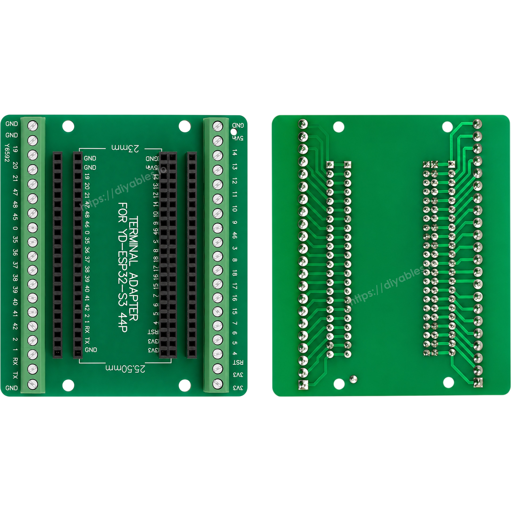
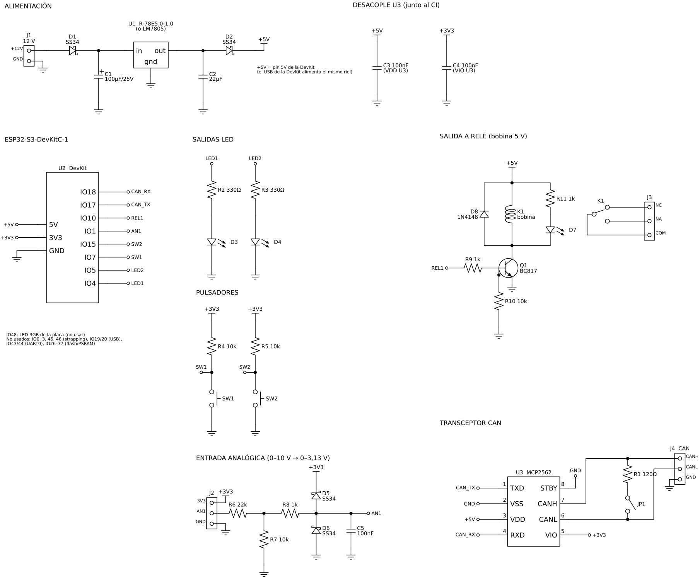

## Propuesta ##

**Título:** Placa carrier para ESP32-S3 DevKit

**Documento de la propuesta:** [Propuesta TP integrador Diseño de Circuitos Impresos.pdf](Propuesta%20TP%20integrador%20Dise%C3%B1o%20de%20Circuitos%20Impresos.pdf)

### Objetivo ###
Diseñar la placa base (carrier) de la placa de desarrollo ESP32-S3 DevKit para su uso en las cátedras de la universidad. Además de expandir los terminales de la DevKit, la placa agrega periféricos para las prácticas:

* Entrada de 12 V con regulador a 5 V, para que la placa funcione sin depender del puerto USB.
* LEDs y pulsadores.
* Salida a relé.
* Transceptor CAN.

Los periféricos se ubican en uno de los laterales de la placa: no donde van los conectores de expansión ni hacia donde apuntan los conectores USB de la DevKit. La placa es de dos capas, con componentes solo en la cara superior.

### Placa de desarrollo ###
ESP32-S3 DevKit de 44 pines (N16R8), vistas superior e inferior:

### Módulo comercial de referencia ###
Placa adaptadora que solo expande los terminales de la ESP32-S3 DevKit. La idea es replicar esa función y agregar los periféricos.

Origen: https://diyables.io/products/screw-terminal-expansion-board-adapter-for-esp32-s3-44-pin

### Esquemático borrador ###
Esquemático presentado con la propuesta (primera versión; el diseño final está en el directorio [pcb](../../pcb)):

